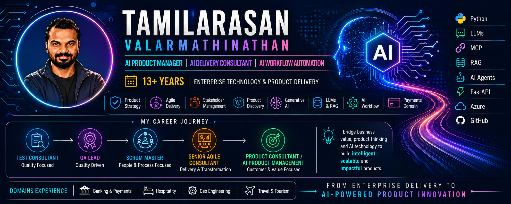

  

  

---

# 👋 Hello, I'm Tamilarasan Valarmathinathan

## AI Product Manager | AI Delivery Consultant | AI Workflow Automation

I am an **AI-focused product professional with 13+ years of experience** across enterprise technology, product strategy, cross-functional leadership and customer-centric solution delivery.

My experience spans **Banking and Payments, Hospitality, Geo Engineering and EdTech**. I focus on translating business problems into AI product opportunities, defining MVP scope, evaluating AI quality and establishing measurable outcomes.

I bring together:

- Product discovery, problem framing and hypothesis development
- MVP definition, prioritization and product metrics
- LLM-powered applications and RAG prototyping
- Prompt, context and retrieval evaluation
- Human-in-the-loop workflows and responsible AI
- Cross-functional delivery and stakeholder alignment
- Enterprise domain expertise and Agile practices

My goal is to connect **customer value, business outcomes and technical feasibility** when shaping practical AI-powered products.

---

# 💼 Professional Experience

## Radiant Consulting — Product Consultant

**February 2026 – Present | EdTech | AI-powered learning platform initiative**

- Explored learner needs across **five capability areas**, translating discovery insights into prioritized opportunities for an AI-powered learning, coaching and mentoring platform.
- Formulated and prioritized hypotheses for personalized coaching, contextual recommendations and skill assessments based on learner needs, expected value and technical feasibility.
- Evaluated candidate AI models and configurations using **Azure AI Foundry and Azure AI**, assessing response quality, contextual relevance, user experience and integration feasibility.
- Defined a measurement framework across **five KPI categories**: learner engagement, learning completion, AI task success, assessment quality and career readiness.

## Tata Consultancy Services — Associate Consultant

**May 2025 – July 2025 | Banking | Centralized Payment Layer**

- Defined a problem and value hypothesis targeting a **25–30% reduction in median investigation time** through streamlined evidence retrieval and workflow orchestration.
- Prioritized **three MVP use cases from 10 candidate workflows** using business value, technical feasibility, operational impact and risk.
- Proposed evaluation criteria covering retrieval relevance, evidence groundedness, recommendation quality, task success and human override.
- Incorporated human review, auditability and controlled integrations into the proposed workflow, with a **20% manual-effort reduction hypothesis** subject to accuracy, safety and operational validation.

## Hotel Jaiwings Management — Senior Agile Consultant

**February 2022 – April 2025 | Hospitality | ERP/CRM transformation and AI guest-journey initiative**

- Identified and prioritized AI opportunities across **four guest workflows**: reservations, cancellations, booking modifications and service discovery.
- Defined AI capabilities spanning guest-intent recognition, contextual recommendations, availability validation and service orchestration.
- Established performance criteria covering task success, intent accuracy, action execution success and human escalation.
- Supported incremental rollout planning across **eight Hotel Management System modules**, aligning delivery priorities, technical dependencies, risks and production-readiness criteria.

## MFB Geotech Private Limited — Scrum Master

**October 2020 – December 2021 | Geo-engineering | SAP / hydro-power application**

- Led Agile delivery for a web application supporting a large-scale hydro-power program.
- Coordinated integration touchpoints with SAP-based enterprise systems and applied SAFe practices in an enterprise energy-sector environment.

## Fidel Technology Solutions Private Limited — Scrum Master

**August 2018 – September 2020 | Banking | Data migration application**

- Supported delivery of a migration from a legacy monolithic core banking system to a digital banking platform based on microservices.
- Coordinated requirements, validation and delivery across a microservices-based cloud deployment structure.

## Skylim Services Private Limited — Software Test Consultant

**May 2013 – July 2018 | Banking | Integrated financial management**

- Supported finance transformation across account, reporting, transaction-validation and business-operation workflows.
- Validated technical and business requirements using high-volume transaction data and supported timely reporting across business operations.

---

# 📈 Selected Product Outcomes

The following outcomes are reported in my CV:

- **12% increase in 30-day learner retention** through personalized learning plans, progress tracking and engagement interventions.
- **28% increase in monthly active learners** through personalized, AI-powered learning journeys and contextual skill recommendations.
- **30% improvement in decision-making efficiency** through Generative AI-enabled delivery workflows, using decision latency as a key outcome metric.

---

# 🧪 Side Project

## 📚 DOCMIND — Enterprise RAG Knowledge Assistant

**An enterprise document knowledge assistant built with Azure AI.**

DOCMIND explores how enterprise documents can be transformed into a grounded conversational knowledge experience, emphasizing retrieval quality, answer grounding and traceable sources.

### Core capabilities

- PDF document processing and text extraction
- Document chunking and embedding generation
- Retrieval using Azure AI Search
- LLM-powered grounded responses
- Page-level citations for source traceability
- Out-of-scope question handling
- Automated evaluation of answer quality

### Technology

`Python` `Azure AI Foundry` `Azure AI Search` `GPT-5-mini` `text-embedding-3-small` `RAG`

**Repository:** [Explore DOCMIND on GitHub](https://github.com/tamilarasan-ml/docmind-rag)

*DOCMIND is the only featured side project in this version. Additional projects will be added later.*

---

# 🧠 Product & AI Capabilities

### Product Management

- Problem framing and product discovery
- Hypothesis development and discovery planning
- MVP definition and prioritization
- Requirements and acceptance criteria
- Roadmap planning and product metrics
- Customer-centric product development

### AI Product Quality

- LLM application prototyping
- Retrieval-Augmented Generation (RAG)
- Prompt and context design
- Evaluation criteria and retrieval evaluation
- Groundedness and citation traceability
- Refusal behavior and human-in-the-loop design
- Guardrails and responsible AI

### Delivery & Collaboration

- Cross-functional delivery
- Dependency and risk management
- Agile, Scrum, Lean and Kanban practices
- SAFe
- Jira, Confluence, GitHub and Jenkins

---

# 🛠️ Technology Toolkit

### AI & Data

`Azure AI Foundry` `Azure AI Search` `OpenAI` `LLMs` `RAG` `LangGraph` `OpenAI Agents SDK` `Databricks` `PySpark` `text-embedding-3-small`

### Development & Integration

`Python` `SQL` `Microservices` `REST APIs` `No-code prototyping` `GlideApps`

### Cloud & Delivery

`Azure` `AWS` `GitHub` `Jenkins` `CI/CD` `Jira` `Confluence` `Azure DevOps`

### Ways of Working

`Product Discovery` `MVP Prioritization` `Agile` `Scrum` `Lean` `Kanban` `SAFe`

---

# 🏅 Certifications

- Professional Scrum Master I (PSM I)
- Professional Scrum Master II (PSM II)
- SAFe 6.0 Advanced Scrum Master (SASM)
- Certification in Artificial Intelligence and Machine Learning
- Microsoft AI Product Manager Professional Certification — **In progress**

---

# 📊 GitHub Analytics

  
  

  

---

# 🎯 Current Focus

- AI product discovery and MVP definition
- AI quality, evaluation and measurable product outcomes
- Grounded LLM applications and RAG
- Responsible AI and human-in-the-loop workflows
- AI-enabled learning and enterprise workflows

---

# 📫 Let's Connect

  
  
  

---

**Product thinking + domain expertise + responsible AI + measurable outcomes**

⭐ Thanks for visiting my GitHub profile. I welcome opportunities to connect, exchange ideas and build practical AI-powered products.
